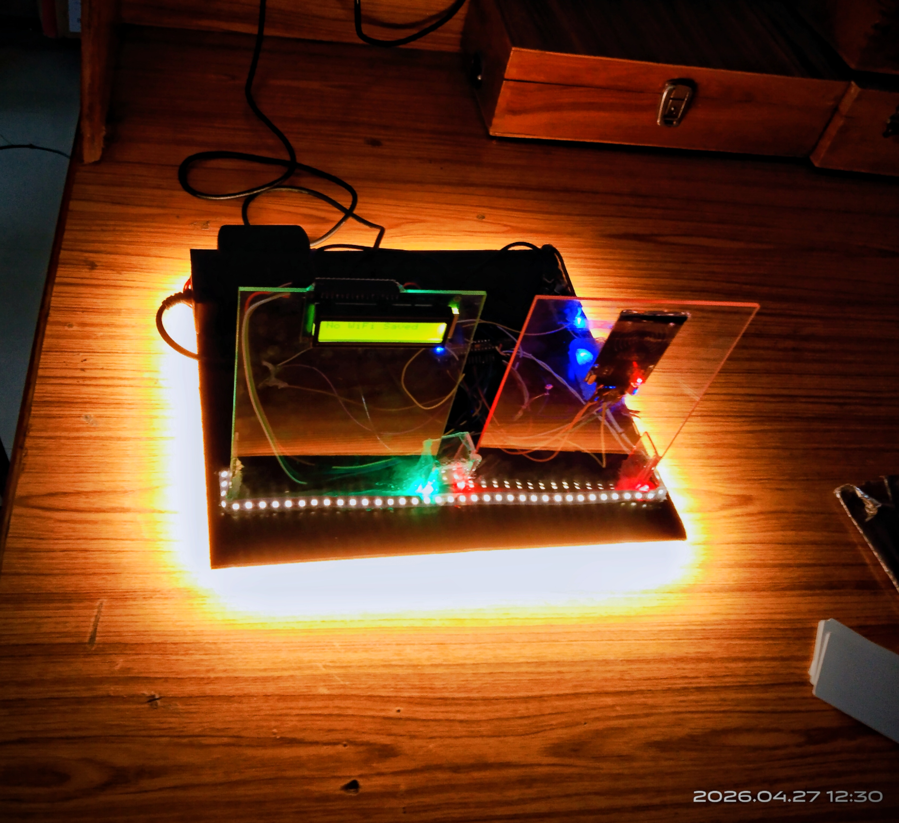

# Attendance-Monitoring-System-using-RFID
RFID-Based Attendance Monitoring System  This project presents a smart and efficient RFID-Based Attendance Monitoring System designed using NodeMCU ESP8266. The system aims to simplify and automate the traditional attendance process by enabling fast, secure, and contactless identification of individuals through RFID technology.

## Project Gallery

1. Project Overview

The RFID-Based Attendance Monitoring System is an IoT-based project developed using the NodeMCU ESP8266 microcontroller.

The system uses RFID technology to identify users through RFID cards/tags and sends attendance-related data to Google Sheets through Wi-Fi connectivity.

It provides a simple and efficient approach to digital attendance monitoring.

2. Hardware Components

Component| Purpose
NodeMCU ESP8266| Main microcontroller
MFRC522 RFID Reader| Reads RFID cards/tags
RFID Card/Tag| User identification
16×2 I2C LCD| Displays system messages
Buzzer| Audio indication
Jumper Wires| Hardware connections
Power Supply| Powers the circuit

3. Software & Technologies

- Embedded C / Arduino C++
- Arduino IDE
- ESP8266 Wi-Fi Library
- MFRC522 RFID Library
- SPI Communication
- I2C Communication
- HTTPSRedirect Library
- Google Apps Script
- Google Sheets

4. Working Principle

1. The NodeMCU ESP8266 initializes the RFID reader and LCD.
2. The system connects to a Wi-Fi network.
3. The LCD displays a message asking the user to scan an RFID card.
4. The MFRC522 reader detects and reads the RFID card.
5. The microcontroller reads the stored information from the RFID card.
6. The collected data is formatted into a JSON payload.
7. The ESP8266 sends the data to Google Sheets through an HTTPS connection.
8. The attendance-related information can be monitored through the Google Sheets interface.

5. Key Features

- Contactless RFID-based identification
- Wi-Fi-enabled data communication
- LCD-based status display
- Google Sheets integration
- Automated data submission
- Microcontroller-based embedded system

6. Applications

- Educational Institutions
- Offices and Workplaces
- Libraries
- Laboratories
- Employee Attendance Monitoring

7. Skills Demonstrated

- Microcontroller Programming
- Embedded C / Arduino Programming
- RFID Communication
- SPI and I2C Interfaces
- Wi-Fi Connectivity
- IoT-Based Data Communication
- Hardware Integration
- Electronic Circuit Implementation

8. Future Improvements

- Real-time attendance dashboard
- User authentication and access control
- Duplicate attendance prevention
- Improved network error handling
- PCB-based hardware implementation
- Cloud-based attendance analytics

9. Project Objective

The main objective of this project is to understand the practical implementation of embedded systems, RFID communication, wireless connectivity, and IoT-based data monitoring.

This project provided hands-on experience in integrating electronic hardware with microcontroller programming and cloud-based data communication.
